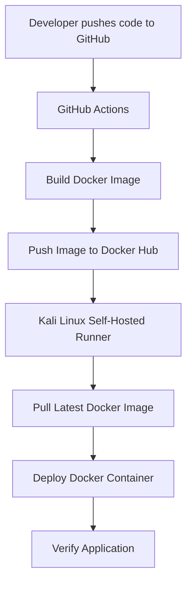

# Dockerized Node.js Service with CI/CD Deployment

A containerized Node.js application with an automated CI/CD pipeline using GitHub Actions, Docker, Docker Hub, and a self-hosted GitHub Actions runner on Kali Linux.

The project demonstrates automated Docker image building, publishing, and deployment whenever new code is pushed to the `main` branch.

## Project Overview

This project contains a simple Node.js application with two endpoints:

- `/` – Returns a Hello World message.
- `/secret` – A protected endpoint that requires HTTP Basic Authentication.

The application is packaged into a Docker image and deployed automatically to a Kali Linux virtual machine using GitHub Actions.

## Architecture



## Technologies Used

- **Node.js & Express.js** – Backend application
- **Docker** – Application containerization
- **Docker Hub** – Docker image registry
- **Git & GitHub** – Version control and source code management
- **GitHub Actions** – CI/CD automation
- **Kali Linux** – Self-hosted deployment environment
- **YAML** – GitHub Actions workflow configuration
- **Linux Shell** – Deployment commands

## Application Features

### 1. Public Endpoint

```http
GET /
```

Response:

```text
Hello, world!
```

### 2. Protected Endpoint

```http
GET /secret
```

This endpoint uses HTTP Basic Authentication.

- Valid credentials return the secret message.
- Missing or incorrect credentials return HTTP 401 Unauthorized.

Example:

```bash
curl -u USERNAME:PASSWORD http://localhost:3000/secret
```

## Docker Implementation

The application is packaged using a Dockerfile.

Build the image:

```bash
docker build -t dockerized-node-service:1.0 .
```

Run the container:

```bash
docker run -d \
  --name my-node-container \
  -p 3000:3000 \
  --env-file .env \
  dockerized-node-service:1.0
```

The application is accessible on port `3000`.

## CI/CD Pipeline

GitHub Actions automates the build, push, and deployment process.

### Job 1: Build and Push

Runs on a GitHub-hosted Ubuntu runner.

1. Checks out the repository.
2. Authenticates with Docker Hub.
3. Builds the Docker image.
4. Pushes the image to Docker Hub.

### Job 2: Deploy

Runs on a self-hosted GitHub Actions runner installed on Kali Linux.

1. Waits for the build-and-push job to complete.
2. Pulls the latest Docker image from Docker Hub.
3. Removes the previous application container.
4. Starts a new container with the required environment variables.
5. Verifies the application endpoints.

### Pipeline Trigger

The workflow automatically runs whenever code is pushed to the `main` branch.

Workflow file:

```text
.github/workflows/docker-build-push.yml
```

## GitHub Actions Secrets

The following repository secrets are configured:

| Secret | Purpose |
|---|---|
| `DOCKERHUB_USERNAME` | Docker Hub username |
| `DOCKERHUB_TOKEN` | Docker Hub authentication |
| `APP_SECRET_MESSAGE` | Application secret message |
| `APP_AUTH_USERNAME` | Application authentication username |
| `APP_AUTH_PASSWORD` | Application authentication password |

Sensitive credentials are not committed to the repository.

## Deployment Environment

| Component | Configuration |
|---|---|
| Deployment platform | Kali Linux (VirtualBox VM) |
| Container runtime | Docker |
| Container name | my-node-container |
| Container image | heerkakkar/dockerized-node-service:latest |
| Application port | 3000 |
| Deployment method | GitHub Actions self-hosted runner |

## Verification and Testing

The deployment was verified successfully.

### Check running container

```bash
docker ps
```

### Test public endpoint

```bash
curl http://localhost:3000/
```

Expected response:

```text
Hello, world!
```

### Test protected endpoint

```bash
curl -i -u USERNAME:PASSWORD http://localhost:3000/secret
```

Expected result:

```text
HTTP/1.1 200 OK
```

The application returns the configured secret message when valid credentials are provided.

## Project Structure

```text
dockerized-node-service/
│
├── .github/
│   └── workflows/
│       └── docker-build-push.yml
│
├── .dockerignore
├── .gitignore
├── Dockerfile
├── package.json
├── package-lock.json
├── server.js
└── README.md
```

## Key Learnings

Through this project, I gained practical experience with:

- Containerizing a Node.js application using Docker.
- Building and publishing Docker images.
- Creating automated CI/CD workflows using GitHub Actions.
- Configuring a self-hosted GitHub Actions runner.
- Deploying Docker containers on a Linux machine.
- Managing application credentials using GitHub repository secrets.
- Verifying deployments using Docker commands and HTTP requests.

## Future Improvements

- Deploy the application on a cloud-based virtual machine.
- Configure HTTPS using a reverse proxy.
- Implement automated container health checks.
- Add monitoring and logging.
- Explore Kubernetes-based deployment and scaling.

---

**Project:** Dockerized Node.js Service with CI/CD Deployment

**Docker Hub:** https://hub.docker.com/r/heerkakkar/dockerized-node-service
